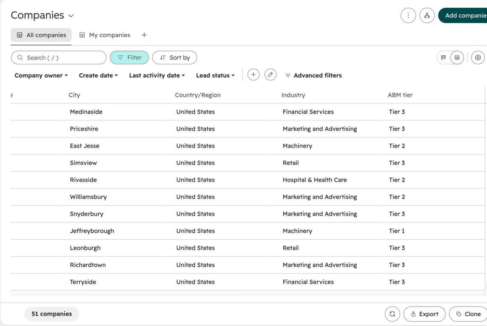
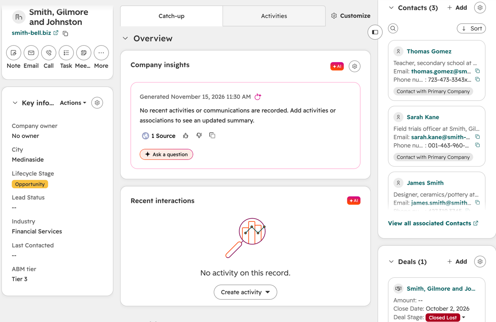
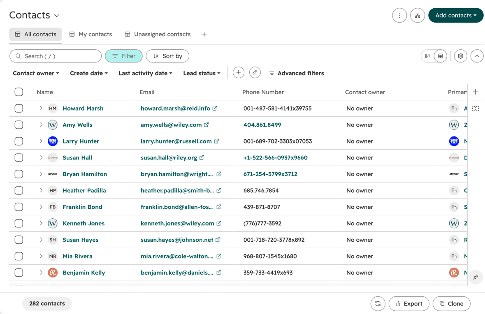
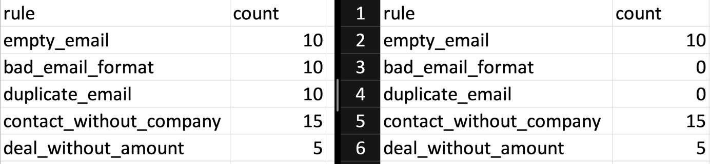

# CRM data quality and ABM segmentation

CRM data (50 companies, 300 contacts, 30 deals) with deliberate errors is loaded into HubSpot. Five Python rules find the errors, two cleaning passes fix what can be fixed, and the companies are ranked into three ABM tiers.

## What is inside

| Path | What it does |
|------|--------------|
| `src/generate_data.py` | Generates the CSV files with planted errors into `data/`. |
| `src/load_to_hubspot.py` | Loads companies, contacts and deals into HubSpot. |
| `src/quality_checks.py` | Runs the five rules and prints the problems found. |
| `src/report.py` | Writes `reports/quality_before.xlsx`. |
| `src/cleanup.py` | Two cleaning passes and their reports. |
| `src/abm_scoring.py` | Scores companies and writes `reports/abm_tiers.xlsx`. |
| `data/clean/` | Cleaned data with a `review_note` column on rows that need a person. |
| `reports/` | `quality_before.xlsx`, `quality_after_cycle1.xlsx`, `quality_after_cycle2.xlsx`, `abm_tiers.xlsx`. |
| `screenshots/` | Screenshots of the result in HubSpot and in the reports. |

## Requirements

- Python.
- A HubSpot private app token with access to contacts, companies and deals, and write access to company properties.
- A `.env` file in the project folder:

```
HUBSPOT_TOKEN=your_token
```

## How to run

```bash
pip install -r requirements.txt
python src/generate_data.py            # writes the CSV files to data/
python src/load_to_hubspot.py          # dry run, prints what it would send
python src/load_to_hubspot.py --apply  # really writes to HubSpot
python src/quality_checks.py           # prints the problems found
python src/report.py                   # reports/quality_before.xlsx
python src/cleanup.py                  # two cleaning passes and their reports
python src/abm_scoring.py              # reports/abm_tiers.xlsx
python -m pytest
```

Every script that writes to HubSpot is a dry run by default and writes only with `--apply`. This also works for `cleanup.py` and `abm_scoring.py`.

## Results

### Data quality

Problems found by each rule:

| Rule | Before | After cycle 1 | After cycle 2 |
|------|-------:|--------------:|--------------:|
| `empty_email` | 10 | 10 | 10 |
| `bad_email_format` | 10 | 8 | 0 |
| `duplicate_email` | 10 | 0 | 0 |
| `contact_without_company` | 15 | 15 | 15 |
| `deal_without_amount` | 5 | 5 | 5 |
| **total** | **50** | **38** | **30** |

- Cycle 1 strips spaces, lowercases emails and drops contacts entered twice. It removed 10 repeated contacts (300 down to 290) and fixed 2 emails that had a space inside.
- Cycle 2 repairs the other 8 broken emails using the domain of the contact's company, for example `user@cole-walton` becomes `user@cole-walton.com`.
- The 30 problems that are left cannot be fixed by a rule: a missing email, a missing company or a missing deal amount has to be looked up by a person. These rows are marked in the `review_note` column in `data/clean/`.

### Loaded into HubSpot

- 50 companies, 270 contacts and 30 deals.
- 30 contact rows were not loaded: 20 had no valid email and 10 repeated an email that was already loaded.
- `cleanup.py --apply` creates the 10 contacts whose email was repaired.

### ABM tiers

Each company gets a score from 0 to 8:

- up to 3 points for the number of contacts;
- up to 3 points for the sum of its deals (lost deals are not counted);
- 1 point for having a domain;
- 1 point for having an industry.

A score of 7 or more is Tier 1, 5 or 6 is Tier 2, the rest is Tier 3.

| Tier | Companies | Deal sum |
|------|----------:|---------:|
| Tier 1 | 7 | 963,000 |
| Tier 2 | 18 | 729,000 |
| Tier 3 | 26 | 23,000 |

That is 51 companies and not 50: a new HubSpot account comes with its own sample company and it was scored too. It is in Tier 3.

## Screenshots

Companies in HubSpot with the `ABM tier` column filled in by `abm_scoring.py`. 51 with HubSpot's own sample company:



A company card with its contacts, its deal and the `ABM tier` field. The only deal is lost, so it is not counted and the company is in Tier 3:



Contacts after `cleanup.py --apply`. The 10 on top are the ones whose email was repaired. 282 = 270 loaded + 10 repaired + 2 HubSpot sample contacts:



The `summary` sheet of `quality_before.xlsx` (left) and of `quality_after_cycle2.xlsx` (right):


